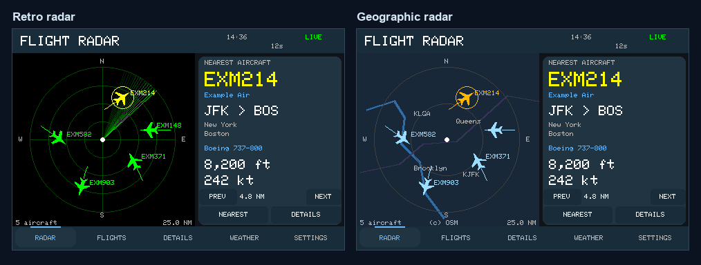
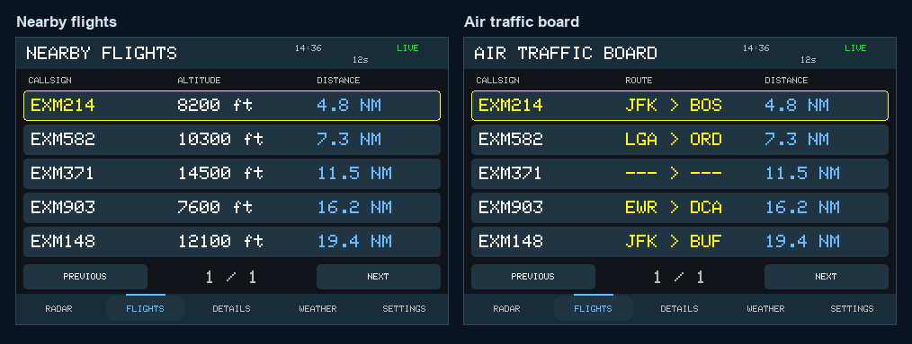
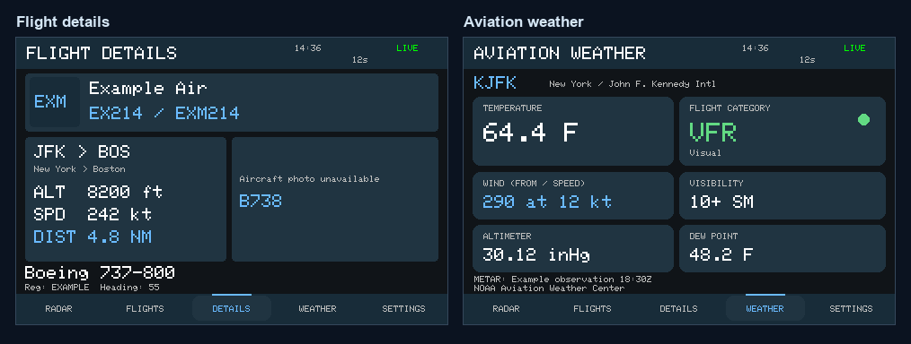
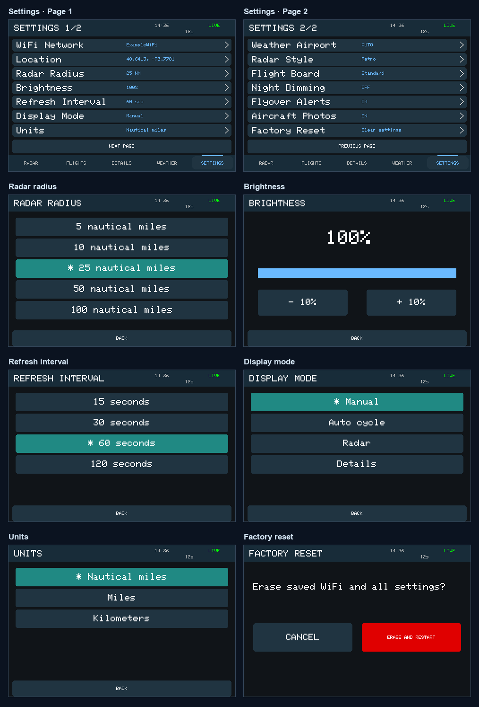
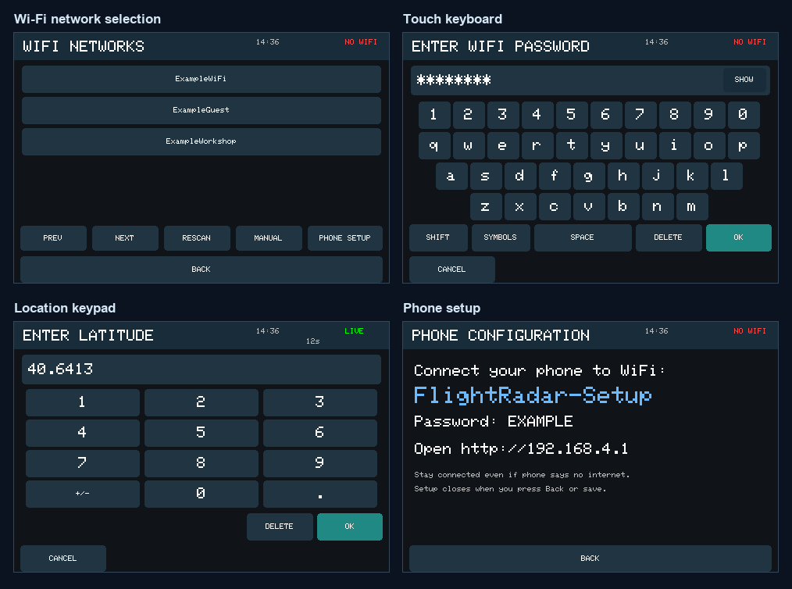
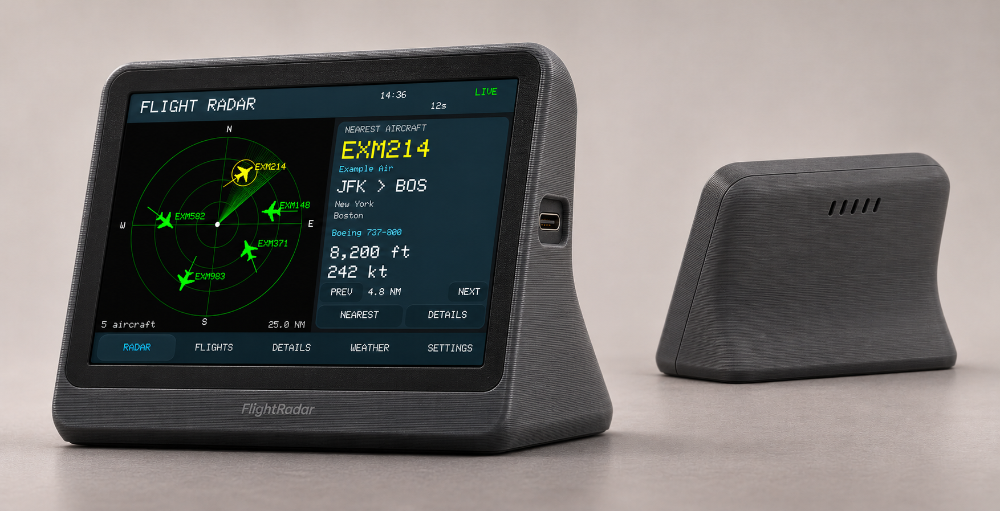

# ESP32 FlightRadar

A standalone 3.5-inch touchscreen that shows the aircraft around you and the latest available weather observation from a nearby airport. Follow a flight across the radar, tap it for route and aircraft details, or leave the display cycling through its main screens.

[Get v7.3.6](https://github.com/EarthlyAcorn020/ESP32-FlightRadar/releases/tag/v7.3.6) · [Hardware and GPIOs](docs/HARDWARE.md) · [Installation](docs/INSTALLATION.md) · [Troubleshooting](docs/TROUBLESHOOTING.md)

*The renders in this README are reconstructed from the v7.3.6 display code at its 480 × 320 layout. Aircraft, network names, weather readings and map geometry are illustrative.*

## Radar

- **Retro** shows a green sweep, four range rings, compass marks, and a dark background. Aircraft icons rotate with their reported heading, and short trails show their recent reported positions.
- **Geographic** adds nearby city and town labels, selected rivers and motorways, and reporting airport markers where data is available. It uses a small vector overlay sourced from OpenStreetMap via Overpass.
- **Choose what to follow.** Tap an aircraft or its label, use **Prev** and **Next**, or tap **Nearest** to follow the closest aircraft as the list updates. The side card shows its callsign, available airline and route, aircraft model, altitude, speed, and distance. Tap **Details** to open the full flight page.
- **Set the area you want to watch.** The center is configurable, and the radius choices are 5, 10, 25, 50 and 100 nautical miles. The firmware keeps up to 80 nearby airborne tracks ordered by distance.
- **Flyover alerts** can show a callsign and estimated minutes in the header if the current speed and heading suggest an aircraft will pass within about 1 NM of the center in the next five minutes. This estimate uses straight-line motion.

## Flight list and traffic board

**Standard** lists callsign, altitude, and distance. **Airport board** replaces altitude with origin and destination codes as route data becomes available. Both views sort by distance from the radar center, display five aircraft per page, and open the full details when you tap a row. The board shows nearby airborne traffic, so it can include flights passing between other airports.

## Aircraft details and aviation weather

### Flight Details

See the airline, flight number and callsign, departure and arrival airports, and available city names. The screen also shows aircraft type or model, registration, heading, altitude, ground speed and distance. Route and model lookups load in stages, with recent results cached. An airline badge shows the logo when available, with a callsign prefix as a fallback.

When **Aircraft Photos** is enabled, the firmware looks for an available aircraft thumbnail. It can also show a Wikimedia Commons reference photo matching the operator and model, with a reference label and attribution. If the photo is disabled, unavailable, or still loading, the display shows a status and the aircraft type in that panel.

### Aviation Weather

The weather tab turns a recent NOAA Aviation Weather Center METAR into cards for temperature, dew point, wind direction and speed, visibility, altimeter setting, and flight category. The category color distinguishes **VFR**, **MVFR**, **IFR**, and **LIFR** when the station reports one. The screen shows the station identifier, airport name, and observation time when supplied.

Set **Weather Airport** to **AUTO** to use the closest reporting airport returned by the nearby search, or enter a four-letter ICAO identifier such as `KJFK`. A loading or no-METAR panel appears when an observation is unavailable.

## Settings and display modes

| Setting | What it controls |
| --- | --- |
| Wi-Fi Network | Scan, page through results, rescan, enter a network name manually, or open phone setup. |
| Location | Enter latitude and longitude for the radar center with the signed decimal keypad. |
| Radar Radius | Choose 5, 10, 25, 50 or 100 NM from the saved center. |
| Brightness | Adjust the backlight from 10% to 100% in 10-point steps. |
| Refresh Interval | Select 15, 30, 60 or 120 seconds for flight requests under normal conditions. Provider quotas still apply. |
| Display Mode | **Manual** keeps the selected tab. **Auto cycle** rotates through Radar, Flights, Details and Weather at 15-second intervals. **Radar** or **Details** returns to the chosen page after about 30 seconds of inactivity on the main screens. |
| Units | **Nautical miles** uses NM, knots and feet. **Miles** uses miles, mph and feet. **Kilometers** uses km, km/h, meters and Celsius for temperature and dew point. |
| Weather Airport | Find a nearby reporting station automatically or set a specific ICAO code. |
| Radar Style | Switch between Retro and Geographic. |
| Flight Board | Switch between altitude and route columns on the Flights tab. |
| Night Dimming | Caps brightness at 20% from 22:00 to 07:00 when the local time zone is known. |
| Flyover Alerts | Toggle estimated near-overhead passes in the radar header. |
| Aircraft Photos | Toggle aircraft thumbnails and reference photos. |
| Factory Reset | Confirm to erase Wi-Fi and saved settings and restart. |

The top bar shows the clock, feed status, and the age of the last good flight update when available. The clock uses network time and displays UTC until the local offset is available. The firmware can reconnect to saved Wi-Fi and retry flight updates. Flight data, imagery, map features, and route enrichment depend on external provider coverage.

## First-run Wi-Fi and phone setup

**On the touchscreen:** pick a 2.4 GHz network or enter its name manually. The keyboard has uppercase and symbol modes and a show/hide toggle for the password. The location editor uses a numeric keypad with decimal and sign controls.

**From a phone:** tap **Phone Setup**, join the password-protected `FlightRadar-Setup` network using the code shown on the display, then open `http://192.168.4.1`. The form takes Wi-Fi settings, radar coordinates, radius, brightness, refresh interval, mode, and units. Saving closes setup and reconnects the ESP32. **Back** closes setup without applying changes. Settings persist across reboots.

## Printable desk enclosure

*AI styling concept. The v4 CAD preview shows the geometry in the downloadable print files.*

The v4 enclosure fits around the existing E32R35T-style display board. It uses a 93 mm front face, a slim wedge shell with a 21° viewing tilt, and a right-side USB-C opening. Start with the fit-check piece to verify board mounting and cable clearance on your hardware.

- [Download the complete v4 print package](enclosure/v4/FlightRadar-Desk-v4-Print-Model.zip?raw=true)
- [Fit-check STL](enclosure/v4/FlightRadar-fit-check.stl) · [Front bezel STL](enclosure/v4/FlightRadar-bezel.stl) · [Rear shell STL](enclosure/v4/FlightRadar-shell.stl)
- [Print guide](enclosure/v4/PRINT-GUIDE.md) · [CAD preview](enclosure/v4/FlightRadar-CAD-preview.png) · [Editable OpenSCAD source](enclosure/v4/FlightRadar-Desk-v4.scad)

## Build one

Use a classic 4 MB ESP32, a 320 × 480 ST7796 SPI display, XPT2046 resistive touch, and 2.4 GHz Wi-Fi. The display runs in landscape. Install the included TFT_eSPI configuration, then open `FlightRadar/FlightRadar.ino` in Arduino IDE and select the **Huge APP** partition before uploading.

1. Check [hardware and verified GPIO assignments](docs/HARDWARE.md).
2. Follow the [Arduino and TFT_eSPI installation guide](docs/INSTALLATION.md).
3. On first boot, connect to Wi-Fi and choose your radar center. New installs start with JFK Airport as the example.

See [troubleshooting](docs/TROUBLESHOOTING.md) for display, touch and network issues. The [data sources and privacy guide](docs/DATA-SOURCES.md) covers provider credits, usage limits and location sharing. See the [changelog](CHANGELOG.md) for release history.

## Credits

This project builds on [esp32flight by Łukasz Nowak](https://github.com/theqkash/esp32flight). The upstream MIT notice is retained in [LICENSE](LICENSE). Live data and images have their own terms. FlightRadar is a hobby display.
