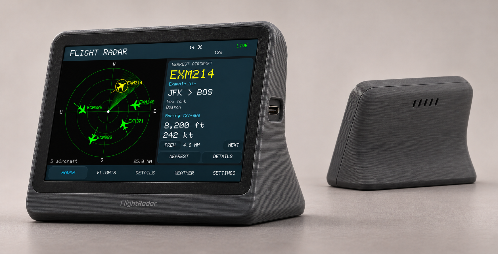

# FlightRadar v4 desk enclosure

*AI styling concept.* [Preview the actual CAD geometry](FlightRadar-CAD-preview.png).

[Download ZIP](FlightRadar-Desk-v4-Print-Model.zip?raw=true) · [Print guide](PRINT-GUIDE.md) · [Editable model](FlightRadar-Desk-v4.scad)

Print the [fit-check STL](FlightRadar-fit-check.stl) before the [bezel](FlightRadar-bezel.stl) and [rear shell](FlightRadar-shell.stl).
